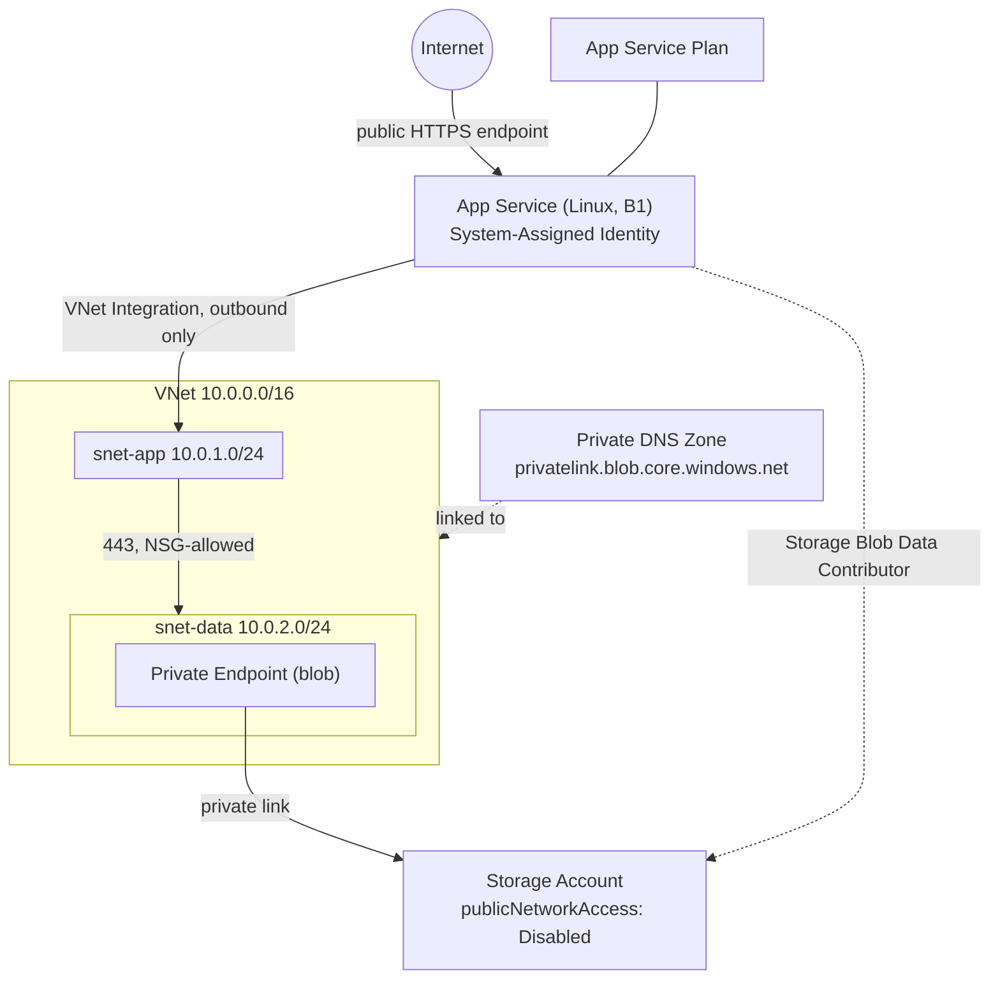

# Azure Secure Landing Zone - Basic

A small, deliberately-scoped Infrastructure-as-Code project: a Linux App Service that reaches
a storage account **only** through a private endpoint, with network segmentation and
data-plane RBAC done the way an AZ-104 exam (and a real environment) expects it to be done.

This isn't meant to be an enterprise landing zone. It's scoped small on purpose - see
[Non-goals](#non-goals--next-steps) below for what's deliberately left out and why.

## Why this project

Three things Azure admins commonly get wrong, built as working
infrastructure:

1. **Service Endpoint vs. Private Endpoint** - a Service Endpoint keeps traffic on the Azure
   backbone, but the resource still has a public IP and is reachable from outside your VNet
   unless you separately lock that down. A Private Endpoint gives the resource an actual
   private IP inside your VNet - traffic never touches a public IP. This project uses a
   Private Endpoint and explicitly disables public network access on the storage account, so
   the private endpoint is the *only* way in, not just *a* way in.
2. **Control-plane vs. data-plane RBAC on storage** - `Storage Account Contributor` manages the
   account (keys, networking, configuration) but grants zero permission to read or write blob
   data. `Storage Blob Data Contributor` is the data-plane role. An app assigned the first role
   will authenticate fine and then get a 403 on every blob operation. This project assigns the
   second role, deliberately, to the app's managed identity.
3. **Resource locks override RBAC** - a `CanNotDelete` lock blocks deletion regardless of the
   caller's role. It's demoed here as a separate, opt-in template specifically so it doesn't
   silently block the teardown script (see [Locks](#optional-resource-lock-demo)).

## Architecture



Note the App Service's *public* inbound endpoint is separate from the VNet entirely - regional
VNet Integration is outbound-only. It lets the app reach into the VNet (to hit the private
endpoint); it doesn't move the app's public entry point into the VNet. That would need an App
Service Environment, a different and much more expensive product.

## What's deployed

| Resource | Purpose | Key decision |
|---|---|---|
| VNet + `snet-app` + `snet-data` | Network segmentation | `snet-app` is delegated to `Microsoft.Web/serverFarms` (required for VNet Integration); delegation and private-endpoint hosting can't share a subnet, hence two subnets |
| NSGs on both subnets | Least-privilege traffic | `snet-data` only accepts inbound 443 from `snet-app`'s range - nothing else, including other subnets you might add later |
| Storage Account | Target data store | `publicNetworkAccess: Disabled`, `allowBlobPublicAccess: false`, TLS 1.2 minimum |
| Private Endpoint + Private DNS Zone | Private connectivity | DNS zone is linked to the VNet so `<account>.blob.core.windows.net` resolves to the private IP automatically - without it, the private endpoint exists but nothing knows to use it |
| App Service Plan + App Service (Linux, B1) | Compute | B1 is the cheapest tier that supports VNet Integration (Free/Shared don't) |
| System-Assigned Managed Identity | App identity | No connection strings or keys stored anywhere - auth to storage is via Entra ID |
| Role Assignment | Data-plane access | `Storage Blob Data Contributor`, scoped to the storage account only (not the whole subscription or resource group) |

## Prerequisites

- Azure subscription with rights to create resource groups and role assignments
- [Azure CLI](https://learn.microsoft.com/cli/azure/install-azure-cli) (includes Bicep support - `az bicep install` if prompted)
- Logged in: `az login`

## Deploy

```bash
git clone <this-repo>
cd azure-secure-landingzone-basic
./scripts/deploy.sh                              # uses defaults: rg-landingzone-basic-demo / germanywestcentral
./scripts/deploy.sh my-rg-name westeurope         # or override both
```

The script runs a `what-if` first and asks for confirmation before actually deploying.

## Tear down

```bash
./scripts/destroy.sh                             # same default RG name
```

This checks for and removes any resource locks (see below) before deleting the resource
group, and blocks until deletion is confirmed - so you're never left thinking it's gone when
it's still billing. **Run this after every session.**

## Optional: resource lock demo

To see the "lock overrides RBAC" behavior for yourself:

```bash
az deployment group create --resource-group <rg> --template-file bicep/locks.bicep
# try deleting something in the portal or via CLI - it will fail regardless of your role
az lock delete --name demo-cannotdelete --resource-group <rg>   # or just run destroy.sh, which does this automatically
```

## Repo structure

```
.
├── README.md
├── .gitignore
├── bicep/
│   ├── main.bicep                # entry point, wires the modules together
│   ├── main.parameters.json
│   ├── locks.bicep                # optional, separate - see above
│   └── modules/
│       ├── network.bicep          # VNet, subnets, NSGs
│       ├── storage.bicep          # storage account, private endpoint, private DNS
│       ├── compute.bicep          # App Service Plan + App Service + VNet Integration
│       └── rbac.bicep             # data-plane role assignment
└── scripts/
    ├── deploy.sh
    └── destroy.sh
```

## Non-goals / next steps

Left out on purpose, to keep this a weekend-sized project rather than an open-ended one:

- **CI/CD pipeline** - this is an admin/infra project, not a DevOps one; a GitHub Actions
  deploy workflow is a natural v2 if that changes.
- **Hub-spoke topology** - this is a single flat VNet. A hub-spoke version (shared firewall/
  DNS in a hub, workloads in spokes) is a logical follow-on project, not folded in here.
- **Outbound NSG hardening / Azure Firewall** - outbound from `snet-app` currently relies on
  default rules beyond the explicit allow to `snet-data`. Restricting egress further (or
  routing it through a firewall) is a reasonable next iteration.
- **Multi-region / HA** - single region, no failover. Out of scope for a portfolio piece
  whose job is to demonstrate the concepts cleanly, not to be production-hardened.

## Cost

Billable resources: App Service Plan (B1, ~€0.02/hour) and the Private Endpoint
(~€0.01/hour), plus negligible storage cost. Nothing here is designed to be left running -
run `destroy.sh` after every session.
